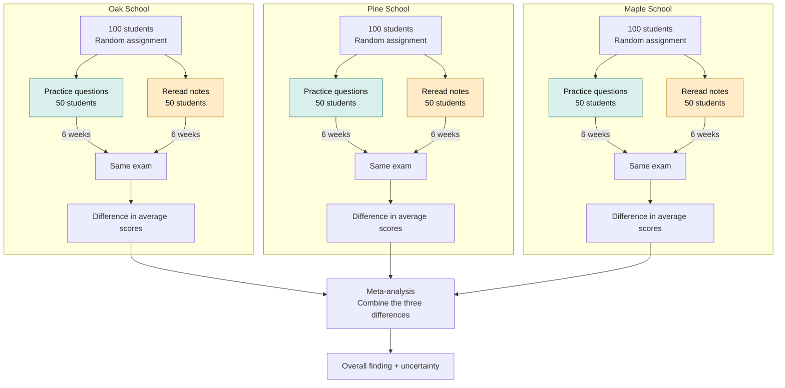

# Combining research results

A [meta-analysis](glossary.md#meta-analysis) combines results from separate [research studies](glossary.md#research-study). Here is an example:

Three fictional schools taught the same course. At each school, 100 students were taught the same material, the same way.  At the end of the course, they were all given the same final exam.  

At each school, students were randomly assigned to two groups. One group prepared for the final exam by using practice questions.  The other group prepared by rereading their notes from class. Students prepared for six weeks, then took the same exam.  We expect students who prepare using practice questions to score higher than students who reread their notes. We will combine the exam results to see whether they support this expectation.

| File | Purpose |
| --- | --- |
| [instruction.md](instruction.md) | The instructions for this meta-analysis task. |
| [research-summaries.md](research-summaries.md) | Three [research summaries](glossary.md#research-summary) and the calculation method. |
| [glossary.md](glossary.md) | Explanations of terms used in this repo. |
| [reference/meta-analysis-solution.md](reference/meta-analysis-solution.md) | The calculations and an example meta-analysis result. |

The participant is the person or AI completing this meta-analysis task. This exercise checks whether the participant can identify the relevant results from each school and follow the [calculation method](research-summaries.md#calculation-method) to combine them. The meta-analysis solution shows the expected final answer of the meta-analysis.

Give the participant only `instruction.md`, `research-summaries.md`, and `glossary.md`.
Keep this overview and the meta-analysis solution out of the materials they can access. 
This repo does not enforce that yet.
